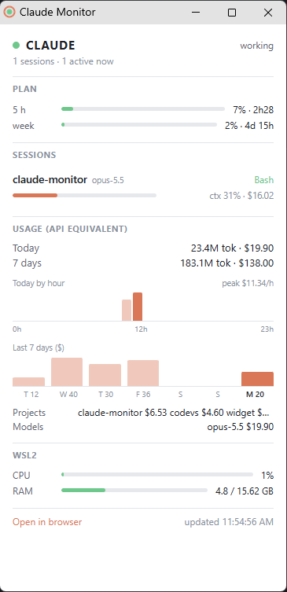
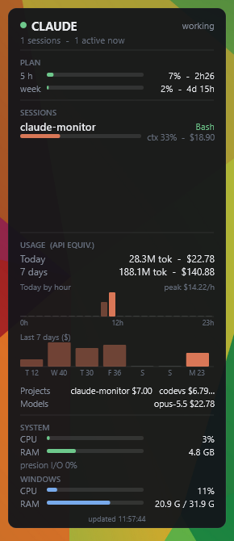

# Claude Monitor

**Claude Code usage, plan limits and live sessions in your system tray.** Windows, macOS, Linux and WSL, in one small Go binary.

<p align="center">
  
  &nbsp;&nbsp;
  
</p>

- **Plan limits.** Shows how much of your 5‑hour window and weekly limit you have used, and when each one resets. The data comes from Claude Code itself.
- **Live sessions.** Lists every open Claude Code session with what it is doing: thinking, the tool it is running, or waiting for your permission. Each one shows its context usage and today's cost. Click a session to jump to it.
- **Usage history.** Shows today's cost per hour and the last 7 days. It breaks today down by project and by model.
- **Notifications.** Alerts you when a session needs permission, when a long task finishes, when context passes 80%, and when you are close to a plan limit.
- **Tray icon at a glance.** The dot shows the status, the ring shows the 5‑hour window and the number shows how many sessions are open.
- **Local only.** It reads the files Claude Code already writes under `~/.claude`. Nothing leaves your machine, and the dashboard listens on `127.0.0.1` only.

> Costs are an **API-equivalent estimate** computed from token counts and public per-model prices. On a Pro/Max subscription you are not billed this amount. It is a useful measure of how hard you are using the plan.

## Install

**macOS · Linux · WSL**

```sh
curl -fsSL https://raw.githubusercontent.com/GuillermoParedes/claude-monitor/main/scripts/install.sh | sh
```

**Windows (Claude Code running natively)**

```powershell
irm https://raw.githubusercontent.com/GuillermoParedes/claude-monitor/main/scripts/install.ps1 | iex
```

The installer does four things:

1. It copies the binary to `~/.local/bin`, or to `%LOCALAPPDATA%\Programs\claude-monitor` on Windows.
2. It adds hooks and a `statusLine` to `~/.claude/settings.json`. It keeps your existing hooks, writes a backup next to the file, and works if `settings.json` is a symlink into your dotfiles.
3. It sets the app to start at login: a Run key on Windows, a LaunchAgent on macOS, and XDG autostart or a systemd user service on Linux.
4. It starts the app.

Sessions that were already open show up after their next tool call. Plan limits appear after Claude Code's next response.

### WSL

If you run Claude Code inside WSL, run the `install.sh` command **inside WSL**. The collector then runs in WSL as a systemd user service. The installer also downloads the Windows tray app, starts it at Windows login, and points it at the collector over `localhost`. Clicking a session can bring Windows Terminal to the front, and it focuses the exact [herdr](https://herdr.dev) pane if you use herdr.

### Already have a status line?

The installer keeps it. Claude Monitor puts its own status line in front so it can capture the plan limits, then runs your original command with the same input. Your bar looks exactly as it did before. `claude-monitor uninstall` puts your original setting back.

## Usage

| | |
|---|---|
| **Left-click the tray icon** | Opens the floating panel. On macOS the icon opens the menu, and the panel is its first item. |
| **Right-click the tray icon** | Opens the menu with a summary, the session list, notifications on/off and Quit. |
| **Click a session** | Goes to that session: it focuses the herdr pane and/or brings its terminal app to the front. |
| **Right-click a session** | Opens the session's folder, or a new terminal in it. |

```text
claude-monitor status [--json]      print the current state
claude-monitor open [--panel]       open the dashboard (--panel: compact floating window)
claude-monitor doctor               check hooks, statusline, collector and plan-limit capture
claude-monitor focus <session-id>   go to a session (also: folder, terminal)
claude-monitor uninstall [--purge]  remove hooks/statusline/autostart (--purge also deletes data)
```

> On Windows the binary is a GUI app, so it never opens console windows. To see CLI output in PowerShell, pipe it, for example `claude-monitor status | Out-String`.

The dashboard is served at <http://127.0.0.1:47821/>. Rainmeter and other tools can read the same data at `/api/state` (JSON) or `/state.txt` (`KEY=value`).

## Integrations (optional, auto-detected)

- **[herdr](https://herdr.dev).** If a session runs in a herdr pane, clicking it focuses that exact pane. This works even when herdr lists the same session in two panes after a `--resume`.
- **Terminals.** "Go to session" brings the hosting app to the front: Windows Terminal, VS Code, iTerm2, Terminal.app, WezTerm or Ghostty.
- **Rainmeter (Windows).** An optional desktop skin is included. Download `claude-monitor_rainmeter-skin.zip` from the [latest release](https://github.com/GuillermoParedes/claude-monitor/releases/latest), unzip it into `Documents\Rainmeter\Skins\`, and load `ClaudeMonitor.ini`.

## Configuration

Settings are stored in `~/.claude/monitor/`:

| File | What |
|---|---|
| `config.json` | `port`, `notifications`, `lang` (`"en"` / `"es"`; the default follows the system) |
| `prices.json` | USD per million tokens by model. Edit it and the history is recalculated automatically |
| `claude-monitor.log` | log of the background process |

If you use `CLAUDE_CONFIG_DIR`, Claude Monitor follows it.

## How it works

```
Claude Code ──hooks──────▶ claude-monitor hook      ─▶ sessions/<id>.json   (what each session is doing)
            ──statusLine─▶ claude-monitor statusline ─▶ limits.json         (5h / weekly plan limits)
            ──transcripts (~/.claude/projects/*.jsonl)                       (tokens → cost, context %)
                                    │
                         claude-monitor run  (collector + 127.0.0.1:47821)
                                    │
                    tray icon · floating panel · Rainmeter · /api/state
```

- **Token counts are deduplicated** by message id. Claude Code writes one transcript line per content block, all carrying the same `usage`, and `--resume` copies history into a new file. Counting naively roughly doubles the totals.
- **Transcripts are read incrementally**, from the byte offset where the last read stopped. A refresh normally takes a few milliseconds.

## Build from source

```sh
go build ./cmd/claude-monitor                                          # current platform
GOOS=windows go build -ldflags "-H windowsgui" ./cmd/claude-monitor    # Windows tray app
```

On macOS the tray uses Cocoa through cgo, so build on a Mac (`CGO_ENABLED=1`). Linux and Windows builds need no cgo.

## License

[MIT](LICENSE)
